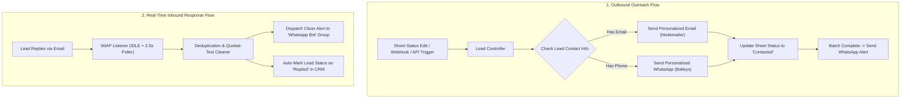

# WhatsApp & Email Outreach Bot Engine

An automated CRM outreach and real-time response alerting system built with **Node.js (ES Modules)**, **Express**, **@whiskeysockets/baileys** (WhatsApp Web socket), **Nodemailer** (outbound SMTP), **IMAP** (inbound reply listener), and **Google Sheets API**.

---

## Architecture & System Flow



---

## Key Features

1. **Sub-2-Second Inbound Email Alerts:**
   * Persistent IMAP connection with `IDLE` socket hooks and 2.5s polling.
   * Direct text/header parser that strips quoted conversation history, MIME headers, and quoted-printable artifacts.
   * Delivers a clean, distraction-free message alert directly into your designated WhatsApp group.

2. **Smart WhatsApp Routing:**
   * Sends alerts directly to your dedicated group (`Whatsapp Bot` / `120363431529677429@g.us`).
   * Configurable via `WHATSAPP_NOTIFICATION_CHAT` in `.env`.
   * Silent during normal sending (no spam); alerts strictly on **new replies**, **batch completions**, or **critical errors**.

3. **Multi-Channel Lead Outreach:**
   * Personalizes messages tailored for legal/immigration firms.
   * Normalizes international phone numbers into clean WhatsApp JIDs.
   * Automatically updates row statuses in your CRM database (`Contacted`, `Replied`, `Failed`).

4. **Dual Data Layer (Google Sheets + Master CSV):**
   * Works directly with your live Google Sheet (`1TRvAySecgQC0PdfNi5YDlJMas3WrdFyRtfPCoNrMOK8`).
   * Seamless local fallback to `data/leads_crm_master.csv` (802 enriched leads across UK, US, Canada, Australia, UAE).

---

## Directory Structure

```text
whatsapp and email bots/
├── data/
│   └── leads_crm_master.csv       # Master CRM database (802 enriched leads)
├── auth_info_baileys/             # WhatsApp session credentials (auto-generated)
├── src/
│   ├── app.js                     # Express app setup & middleware
│   ├── server.js                  # Entry point (boots HTTP server, WhatsApp & IMAP)
│   ├── routes/
│   │   ├── index.js               # Master router (/api)
│   │   ├── lead.routes.js         # Webhook & outreach triggers
│   │   ├── whatsapp.routes.js     # WhatsApp health, groups & test endpoints
│   │   └── email.routes.js        # Email health & SMTP self-test
│   ├── controllers/
│   │   ├── lead.controller.js     # Outreach orchestration & batch execution
│   │   ├── whatsapp.controller.js # WhatsApp API handlers
│   │   └── email.controller.js    # Email status & testing handlers
│   └── services/
│       ├── whatsapp.service.js    # Baileys socket, QR pairing & messaging
│       ├── email.service.js       # Nodemailer SMTP + fast IMAP reply watcher
│       └── sheets.service.js      # Google Sheets client & CSV fallback sync
├── .env.example                   # Environment configuration template
├── package.json                   # Dependencies and npm scripts
└── README.md                      # Documentation
```

---

## API Endpoints Reference

### 1. Lead Outreach Routes (`/api/leads`)

| Method | Endpoint | Description | Payload Example |
| :--- | :--- | :--- | :--- |
| `POST` | `/api/leads/webhook` | Receives Google Sheet `onEdit` webhook triggers. | `{"row": 4, "status": "Ready to Contact"}` |
| `POST` | `/api/leads/trigger-single` | Manually triggers outreach for a specific lead row. | `{"row": 15}` |
| `POST` | `/api/leads/trigger-batch` | Processes leads matching a target status with safety delays. | `{"targetStatus": "Ready to Contact", "limit": 10, "delaySeconds": 25}` |

### 2. WhatsApp Routes (`/api/whatsapp`)

| Method | Endpoint | Description | Payload Example |
| :--- | :--- | :--- | :--- |
| `GET` | `/api/whatsapp/status` | Returns socket connection status and linked user JID. | *None* |
| `GET` | `/api/whatsapp/groups` | Lists all participating WhatsApp groups and their IDs. | *None* |
| `POST` | `/api/whatsapp/pairing-code` | Generates an 8-character pairing code for phone login. | `{"phoneNumber": "923140616029"}` |
| `POST` | `/api/whatsapp/send-test` | Sends a verification message to your designated alert group. | `{"message": "Hello from Bot"}` |

### 3. Email Routes (`/api/email`)

| Method | Endpoint | Description | Payload Example |
| :--- | :--- | :--- | :--- |
| `GET` | `/api/email/status` | Checks SMTP outbound and IMAP inbound health. | *None* |
| `POST` | `/api/email/send-test` | Sends a test email to verify SMTP credentials. | `{"to": "you@gmail.com"}` |

---

## Environment Variables (`.env`)

```ini
PORT=3000

# Google Sheets
GOOGLE_SHEET_ID=1TRvAySecgQC0PdfNi5YDlJMas3WrdFyRtfPCoNrMOK8
GOOGLE_SERVICE_ACCOUNT_EMAIL=
GOOGLE_PRIVATE_KEY=

# Outbound Email (Nodemailer SMTP)
EMAIL_SERVICE=gmail
EMAIL_USER=your_email@gmail.com
EMAIL_PASS=your_16_char_google_app_password

# Inbound Email (IMAP Listener)
IMAP_HOST=imap.gmail.com
IMAP_PORT=993
IMAP_TLS=true

# WhatsApp Notification Group or Chat JID
WHATSAPP_NOTIFICATION_CHAT=120363431529677429@g.us
```

---

## Running the Application

```bash
# Start the server (with auto-restart on changes)
npm run dev

# Or start in standard production mode
npm start
```
